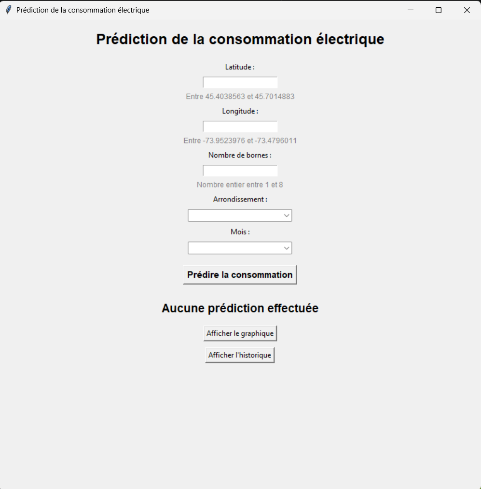

<div align="center">

# ⚡ Énergie Montréal

### Prédiction de la consommation électrique des bornes de recharge

**INF1007 — Projet 2 | Polytechnique Montréal**

Une application Python permettant d'estimer la consommation
électrique mensuelle des bornes de recharge de Montréal.


</div>

---

## 📖 À propos du projet

Ce projet utilise des données publiques de 2025 pour entraîner
un modèle capable de prédire la consommation électrique mensuelle
des bornes de recharge de Montréal.

L'application combine trois composantes :

- **Analyse des données** : lecture, nettoyage et exploration du CSV.
- **Apprentissage automatique** : comparaison et entraînement de modèles.
- **Interface graphique** : prédiction interactive avec Tkinter.

## ✨ Fonctionnalités

| Fonctionnalité | Description |
|---|---|
| 📂 Nettoyage des données | Validation des valeurs et gestion des données manquantes |
| 📊 Exploration | Statistiques et graphiques de consommation |
| 🧠 Prédiction | Estimation mensuelle en kWh avec une forêt aléatoire |
| 🖥️ Interface Tkinter | Saisie de cinq caractéristiques |
| 🛡️ Validation | Contrôle des plages et des types de saisie |
| 🕘 Historique | Enregistrement local des prédictions en CSV |
| 🧪 Tests | Tests automatisés avec pytest |

## 📊 Données utilisées

**8 199 observations valides** après nettoyage.

| Variable | Utilisation |
|---|---|
| Latitude | Caractéristique |
| Longitude | Caractéristique |
| Nombre de bornes | Caractéristique |
| Arrondissement | Caractéristique catégorielle |
| Mois | Caractéristique catégorielle |
| Consommation (KWH total) | Variable cible en kWh |

Les opérations de nettoyage sont centralisées dans
`src/donnees.py`, puis adaptées au modèle par
`src/entrainement.py`.

## 🧠 Modèle de prédiction

Trois approches sont comparées :

1. Modèle de référence basé sur la moyenne
2. Régression linéaire
3. Forêt aléatoire — modèle retenu

### Performances

| Évaluation | RMSE référence | RMSE forêt | R² forêt |
|---|---:|---:|---:|
| Séparation aléatoire | 1 973 kWh | **1 027 kWh** | **0,73** |
| Séparation par borne | 1 912 kWh | **1 481 kWh** | **0,40** |

> **Limite importante**
>
> Une borne peut apparaître plusieurs fois dans le jeu de données.
> La séparation aléatoire peut donc produire des résultats optimistes.
> La séparation par borne offre une évaluation plus pertinente
> sur des bornes jamais vues.

Le modèle est sauvegardé avec `joblib` et les paramètres
de saisie sont conservés dans un fichier JSON.

## 🖥️ Application graphique

L'interface Tkinter permet de saisir :

- Une latitude et une longitude
- Un nombre de bornes
- Un arrondissement
- Un mois

L'utilisateur peut ensuite consulter la prédiction,
afficher un graphique de l'historique et retrouver
les prédictions enregistrées.



## 🛠️ Technologies

| Catégorie | Technologies |
|---|---|
| Langage | Python 3.11 |
| Données | CSV, Pandas, NumPy |
| Visualisation | Matplotlib |
| Apprentissage automatique | Scikit-learn |
| Sauvegarde | Joblib, JSON |
| Interface | Tkinter |
| Tests | Pytest, Coverage |
| Versionnement | Git, GitHub |

## 🚀 Installation et lancement

### 1. Créer un environnement virtuel

```powershell
py -3.11 -m venv .venv
```

### 2. Activer l'environnement sous Windows

```powershell
.\.venv\Scripts\Activate.ps1
```

### 3. Installer les dépendances

```powershell
python -m pip install -r requirements.txt
```

### 4. Lancer l'application

```powershell
python -m src.interface
```

### Autres commandes utiles

| Action | Commande |
|---|---|
| Entraîner le modèle | `python -m src.entrainement` |
| Évaluer le modèle | `python -m src.evaluation` |
| Comparer les séparations | `python -m src.validation_groupes` |
| Exécuter les tests | `python -m pytest -q` |
| Mesurer la couverture | `coverage run --source=src -m pytest` |
| Afficher la couverture | `coverage report -m` |

> Relancer l'entraînement peut remplacer le modèle et ses
> métadonnées sauvegardés.

## 🧩 Architecture et programmation orientée objet

Les principales classes du projet sont :

| Classe | Responsabilité |
|---|---|
| `Modele` | Entraînement, évaluation et prédiction |
| `Prediction` | Représentation d'une prédiction |
| `PredictionRecharge` | Prédiction électrique avec arrondissement |

Le projet met en œuvre l'encapsulation, l'héritage,
le polymorphisme, la composition et les méthodes spéciales.

Le décorateur `chronometre` mesure la durée des entraînements.

## 🧪 Tests et qualité

**40 tests réussis lors de la dernière vérification locale communiquée.**

Les tests portent notamment sur :

- Les conversions et les données manquantes
- Les statistiques descriptives
- L'adaptation des données pour le modèle
- L'entraînement, la prédiction et la sauvegarde
- L'héritage, le polymorphisme et la composition

La couverture globale doit être recalculée après les
dernières modifications.

## 📚 Documentation

- `DECISIONS.md` — Choix techniques et justifications
- `JOURNAL_IA.md` — Utilisation et vérification de l'IA
- `requirements.txt` — Dépendances Python

## 🔗 Références

- [Python](https://docs.python.org/3/)
- [Pandas](https://pandas.pydata.org/docs/)
- [NumPy](https://numpy.org/doc/stable/)
- [Scikit-learn](https://scikit-learn.org/stable/)
- [Matplotlib](https://matplotlib.org/stable/)
- [Pytest](https://docs.pytest.org/en/stable/)

---
## Source des données

Ville de Montréal. (2026).
*Utilisation de bornes de recharge publique pour voitures électriques*.
Données Québec. Licence CC BY 4.0.

https://donneesquebec.ca/recherche/dataset/vmtl-utilisation-bornes-recharge-publique-voiture-electrique

<div align="center">

**INF1007 — Projet 2**

Polytechnique Montréal · 2026


</div>
